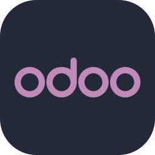

<h1 align="center">Hi, I'm Mohammed Abdullah 👋</h1>
<h3 align="center">Senior Odoo Developer · Fullstack Web Engineer</h3>

📍 Cairo, Egypt · Open to remote work with KSA, UAE &amp; Europe

  &nbsp;&nbsp;
  

### 📫 Find me on

  &nbsp;
  &nbsp;
  &nbsp;
  

---

### 🧑‍💻 About me

I build **ERP systems with Odoo** and **production web apps with React, Next.js, Django and PHP**, working for clients in Saudi Arabia, the UAE and Egypt.

- 🏢 **Senior Odoo Developer** at an Odoo Gold Partner. I lead 9 enterprise Odoo.sh environments (v17–v19).
- 🔁 Migrated **63 custom modules from Odoo v17 to v19** with zero data loss.
- 🇸🇦 Built **40+ Saudi HRMS modules** (Labor Law, EOSB, Iqama, Payroll) plus **ZATCA e-invoicing** integrations.
- 🌐 As a solo fullstack developer, shipped **3 Arabic-first hotel booking platforms** with React 18, TypeScript, PWA, PHP and MySQL, and live PayTabs payments.
- 🎧 Built a **bilingual customer support CRM** with Django REST Framework and React + TypeScript, including AI ticket summaries, reply suggestions and a self-service chatbot.
- 🚚 Built a delivery management system that handles **500+ shipments a day** with SMSA Express and OneStock integrations.
- 🎓 B.Sc. Computer Science · **Odoo Certified Professional (v15)**
- 🗣️ Arabic (native) · English (professional)

---

### 🛠️ Tech stack

**ERP** 
&nbsp; Odoo v11 – v19 · Odoo.sh · OWL · QWeb · Python ORM

**Languages** 

**Frontend & mobile** 

**Backend & data** 

**Tools** 

**Integrations:** ZATCA e-Invoice · PayTabs · Telr · Neoleap POS · SMSA Express · OneStock · Salla API · Google Drive & OneDrive · Gemini AI

---

### 🧩 What I work on in Odoo

| Area | Highlights |
|---|---|
| **HR & Payroll** | Saudi Labor Law compliance, EOSB, Iqama, air tickets, attendance, payroll reports |
| **POS & Retail** | Multi-branch POS, split payments, credit limits, Neoleap payment terminals |
| **Accounting** | ZATCA Phase 1/2 e-invoicing, budgets, financial reports |
| **Inventory & Logistics** | WMS, return pickings, serial tracking, demand-based re-order reports, shipping integrations |
| **Purchasing & Approvals** | Multi-level approval flows, approval requests to RFQ, stock demand locks |
| **Automotive** | Pre-delivery inspection (PDI), port receiving inspection (VRI), VOR requests, vehicle reservations, B2B dealer credit limits |
| **Payments** | Telr and PayTabs gateways, Neoleap POS terminals |
| **APIs & Mobile** | REST APIs with JWT auth for mobile apps, license and subscription activation |
| **Analytics & Automation** | Custom dashboards, revenue projections, probation assessment automation, org chart export to PowerPoint |
| **DevOps** | Automated database backups to Google Drive and OneDrive, Odoo.sh CI/CD |
| **Migrations** | Version upgrades (v11 → v19) and legacy PHP/MySQL → Odoo migrations |

**Industries:** Government · Oil & Gas · Construction & Contracting · Automotive · Retail & POS · Logistics · Consulting · Manufacturing

---

### 🌍 Fullstack projects

| Project | Stack |
|---|---|
| **Customer Support CRM** · tickets, SLAs, knowledge base, customer portal, AI assistant (AR/EN) | Django 5 · DRF · JWT · React · TypeScript · Vite · Tailwind |
| [Covera Solutions](https://covera-solutions.com) · corporate website (AR/EN) | Vite · GSAP · Lenis |
| **AG Academy** · learning platform with Android & iOS apps | React · Supabase · Capacitor |
| [Diafat Kholoud](https://diaftkhulud.com) · hotel booking platform | React · TypeScript · PWA · PHP · MySQL · PayTabs |
| [Diafat Somood](https://diyafahsomood.com) · hotel booking platform | React · TypeScript · PWA · PHP · MySQL · PayTabs |
| [Noura Travel](https://nouratravel.com) · Umrah & travel booking | React · TypeScript · PWA · PHP · MySQL · PayTabs |
| [Development Standards](https://devestandards.com) · corporate website & product catalog | Next.js · Sanity CMS · MUI · Tailwind |
| **Salla Store Automation** · bulk product & catalog updates | Python · Salla Admin API |

---

### 📊 GitHub stats

  
  

### 🐍 Contribution graph

<picture>
  <source media="(prefers-color-scheme: dark)" srcset="https://raw.githubusercontent.com/mhefzallah/mhefzallah/output/github-snake-dark.svg"/>
  <source media="(prefers-color-scheme: light)" srcset="https://raw.githubusercontent.com/mhefzallah/mhefzallah/output/github-snake.svg"/>
  
</picture>

---

💬 Open to <b>Odoo / ERP</b> and <b>fullstack</b> projects. See my work at <a href="https://mhefzallah.github.io">mhefzallah.github.io</a> or contact me on <a href="https://www.linkedin.com/in/mohamed-hefzallah-14297022b/">LinkedIn</a>.

